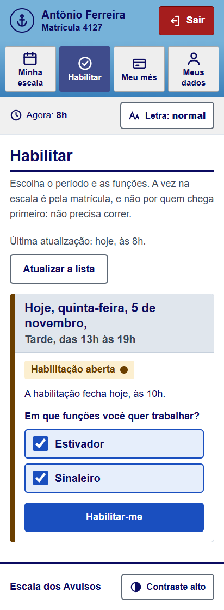
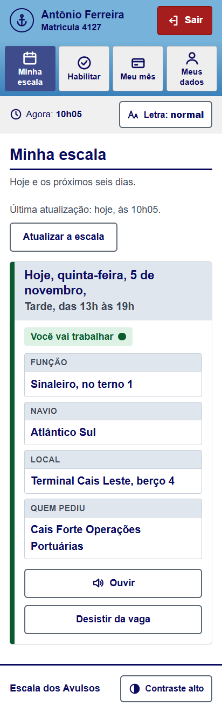
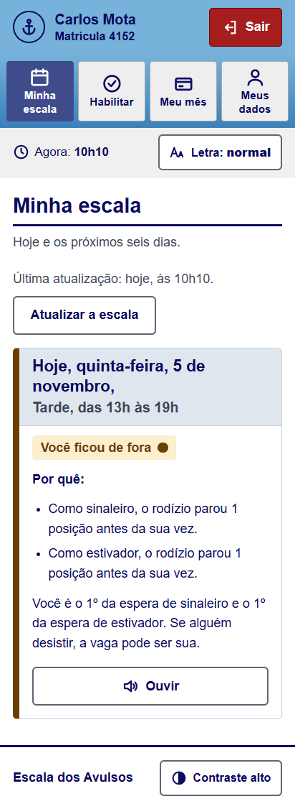
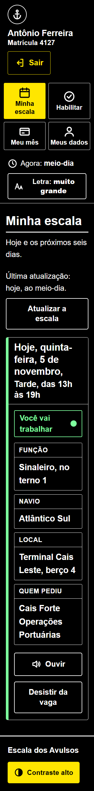
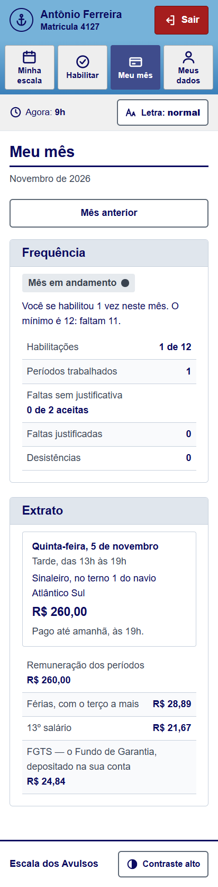
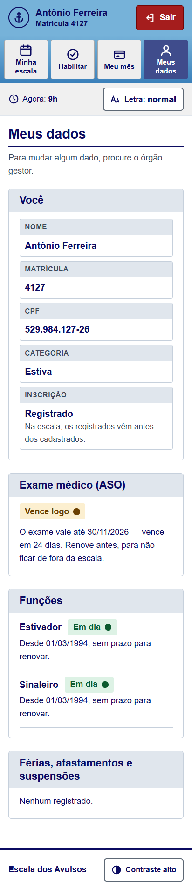

# Escala dos Avulsos

[](https://github.com/MarcusBomfim/escala-avulsos/actions/workflows/ci.yml)
[](https://github.com/MarcusBomfim/escala-avulsos/actions/workflows/e2e.yml)
[](LICENSE)

A escala do trabalhador portuário avulso, feita para o celular e para quem já não enxerga tão bem: o estivador abre o aplicativo e lê, numa frase, onde trabalha amanhã — ou por que ficou de fora, e até quando. Por trás da tela, o que a escala precisa saber: quem pode trabalhar em cada função, o pedido do operador portuário, o rodízio, o descanso entre jornadas, a frequência e o extrato, guardados num PostgreSQL que não deixa ninguém em duas jornadas, uma API em que cada um entra com o seu papel, e o aplicativo do trabalhador, com letra que cresce num toque, contraste alto, a escala lida em voz alta, e que abre sem sinal no cais — e, na próxima parte, os avisos.

C# 14 · .NET 10 · ASP.NET Core · EF Core 10 · PostgreSQL 17 · OpenAPI · React 19 · TypeScript · PWA · TanStack Query · Vitest · Playwright · axe · Testcontainers · xUnit v3 · GitHub Actions

> Projeto independente, de estudo e portfólio. Não tem ligação com o OGMO/Santos nem com nenhum órgão gestor de mão de obra; os nomes de pessoas, empresas, navios e terminais dos exemplos são inventados.

## O problema

No porto de Santos, mais de seis mil trabalhadores portuários avulsos — estivadores, conferentes, vigias, trabalhadores da capatazia — não têm patrão fixo. A cada período de seis horas, o órgão gestor de mão de obra reparte as vagas que os operadores portuários pediram, em rodízio, para que o trabalho se divida entre todos. Desde 2019 a disputa pelas vagas pode ser feita pelo celular, e em 2020, com a pandemia, passou a ser só digital.

Entre esses trabalhadores há muitos com décadas de cais, que aprenderam a profissão na escala presencial, e não no celular. Quem usa o sistema atual todo dia conta que:

- **ele não cabe no celular** — o layout é de computador, e é preciso dar zoom e arrastar para ler;
- **ele não foi feito para quem tem mais idade** — letra pequena, botões pequenos, siglas, caminhos longos;
- **a escala, a tela mais usada, é a mais difícil de ler** — o trabalhador procura a própria matrícula no meio de uma tabela cheia de códigos.

As fontes públicas mostram o resto: o tempo aperta (um trabalhador disse à Justiça do Trabalho que gastava, em média, meia hora no sistema para garantir a inclusão na escala), os avisos importantes saem como notícia no site, e o próprio órgão gestor publicou um PDF sobre limpeza de cache no Android e no iOS. A análise inteira, com as fontes, o que foi possível ver e o que não foi, está em [`docs/analise-do-sistema-atual.md`](docs/analise-do-sistema-atual.md).

Este projeto refaz o sistema com quatro ideias:

- **"Minha escala" primeiro**, numa frase: "Amanhã, quinta, das 7h às 13h: navio Atlântico Sul, Terminal Cais Leste, berço 4 — estivador, terno 2." A escala completa continua lá, com a linha de quem lê destacada.
- **Todo "não" vem com o motivo e com o prazo**: o exame que venceu, o curso de reciclagem, as férias, o descanso de onze horas — e a partir de quando ele volta a poder.
- **Feito para o celular e para os olhos de quem tem mais idade**: letra grande que aumenta com um toque, alto contraste, botões grandes, palavra junto de todo ícone, nenhuma sigla sem explicação — e a escala lida em voz alta.
- **Os avisos chegam ao trabalhador**: quando sai a escala, quando a habilitação vai fechar, quando o exame está para vencer.

## Exemplo

O exemplo inteiro está em [`ExemploDoReadmeTests`](tests/EscalaAvulsos.Dominio.Testes/ExemploDoReadmeTests.cs). É um teste: se o código mudar e alguma frase desta página deixar de ser verdade, o build quebra.

Quarta-feira, 4 de novembro de 2026, 10h. A Cais Forte vai trabalhar o navio Atlântico Sul no Terminal Cais Leste na manhã de quinta, e pede ao órgão gestor dois ternos de estiva — em cada um, um contramestre, um sinaleiro, um operador de guindaste de bordo e oito estivadores:

```csharp
var caisForte = new OperadorPortuario("Cais Forte Operações Portuárias", Cnpj.De("11.222.333/0001-81"));
var atlanticoSul = new Navio("Atlântico Sul", NumeroImo.De("IMO 9876543"));
var quintaDeManha = Periodo.De(new DateOnly(2026, 11, 5), Turno.Manha);

VagasDaFuncao[] terno = [new(contramestre, 1), new(sinaleiro, 1), new(operadorDeGuindaste, 1), new(estivador, 8)];

var requisicao = new Requisicao(
    new DadosDaRequisicao(caisForte, atlanticoSul, new LocalDaOperacao("Terminal Cais Leste", "4"), quintaDeManha),
    [terno, terno], quartaAs10h);
// Cais Forte Operações Portuárias pede 2 ternos da estiva, 22 vagas, para o navio Atlântico Sul (IMO 9876543),
// no Terminal Cais Leste, berço 4, em 05/11/2026, das 7h às 13h.
```

O que o operador pedir errado volta todo de uma vez, dito como se diz no porto — a mesma função escrita de dois jeitos é a mesma função, e cada categoria tem o seu rodízio:

```csharp
new Requisicao(dados, [[new(estivador, 8), new(new Funcao(Categoria.Estiva, "ESTIVADOR"), 2)], [new(conferente, 1)]], quartaAs10h);
// O terno 1 repete estivador: junte as vagas da função numa linha só. A requisição mistura a estiva e a
// conferência de carga: cada categoria tem o seu rodízio, e a sua requisição.
```

Seu Antônio Ferreira, matrícula 4127, é estivador registrado desde 1994. Tem também o curso de sinaleiro, que vale até maio de 2027, e o exame médico vale até 30 de novembro:

```csharp
var antonio = new Trabalhador(new DadosDoTrabalhador(
    Matricula.De("4127"), "Antônio Ferreira", Cpf.De("529.982.247-25"), Categoria.Estiva, Inscricao.Registrado));

antonio.Qualificar(estivador, new DateOnly(1994, 3, 1));
antonio.Qualificar(sinaleiro, new DateOnly(2010, 5, 10), validaAte: new DateOnly(2027, 5, 9));
antonio.RegistrarAso(new Aso(new DateOnly(2025, 12, 1), validoAte: new DateOnly(2026, 11, 30)));
```

Na quinta, ele pode pegar uma vaga de sinaleiro — mas não a de guindaste, que não é a dele:

```csharp
antonio.AptidaoPara(sinaleiro, quintaDeManha);
// Antônio Ferreira (matrícula 4127) pode trabalhar como sinaleiro em 05/11/2026, das 7h às 13h.

antonio.AptidaoPara(operadorDeGuindaste, quintaDeManha);
// Antônio Ferreira (matrícula 4127) não pode trabalhar como operador de guindaste de bordo em 05/11/2026,
// das 7h às 13h: não tem a qualificação de operador de guindaste de bordo.
```

As férias de janeiro já estão marcadas, e ninguém renovou o exame. Para a noite de 5 de janeiro — que começa às 19h e termina à 1h do dia 6 —, o sistema não diz só "não": diz por quê, e cada motivo traz os dias em que impede. É com isso que o aplicativo vai avisar o Seu Antônio, antes de ele ficar de fora da escala sem entender:

```csharp
antonio.Impedir(new Impedimento(TipoDeImpedimento.Ferias, new DateOnly(2027, 1, 4), new DateOnly(2027, 2, 2)));

antonio.AptidaoPara(estivador, Periodo.De(new DateOnly(2027, 1, 5), Turno.Noite));
// Antônio Ferreira (matrícula 4127) não pode trabalhar como estivador em 05/01/2027, das 19h à 1h:
// o exame médico (ASO) vale só até 30/11/2026; está de férias de 04/01/2027 a 02/02/2027.
```

Para a tarde de quinta, das 13h às 19h, a Cais Forte pediu um terno menor: um sinaleiro e dois estivadores. A habilitação abre à 1h e fecha às 10h, e não há corrida: quem se habilita às 9h59 tem a mesma vez de quem se habilitou à 1h, porque a vez é pela matrícula. Quem não pode trabalhar numa função fica sabendo na hora:

```csharp
var escalacao = new Escalacao(Categoria.Estiva, quintaATarde, CalendarioDaEscalacao.Padrao);

escalacao.Habilitar(antonio, [sinaleiro, estivador], quintaAs6h);

escalacao.Habilitar(dirceu, [sinaleiro], quintaAs6h);
// Dirceu Alves (matrícula 4188) não pode se habilitar como sinaleiro: não tem a qualificação de sinaleiro.
```

Seis estivadores se habilitam; o Antônio e o Carlos também como sinaleiros, e o João é cadastrado. O rodízio de sinaleiro tinha parado no Carlos, o de estivador no Benedito, e o Dirceu trabalhou de manhã. Às 10h, a escala sai: a função com menos habilitados primeiro, os registrados antes dos cadastrados, cada um na sua vez — e quem não pode é pulado:

```csharp
var escala = Escalador.Escalar(escalacao, [requisicao], habilitados, [manhaDoDirceu], rodizio, Descanso.DaLei, quintaAs10h);

escala.Engajamentos;
// Antônio Ferreira (matrícula 4127): sinaleiro no terno 1 do navio Atlântico Sul (IMO 9876543), no Terminal Cais Leste, berço 4, …
// Carlos Mota (matrícula 4152): estivador no terno 1 do navio Atlântico Sul (IMO 9876543), …
// Edson Prado (matrícula 4101): estivador no terno 1 do navio Atlântico Sul (IMO 9876543), …
```

E quem ficou de fora sabe por quê, sem procurar o nome numa lista:

```csharp
escala.SituacaoDe(Matricula.De(4130));
// Benedito Lima (matrícula 4130) ficou fora da escala: como estivador, o rodízio parou 2 posições antes da sua vez.

escala.SituacaoDe(Matricula.De(4188));
// Dirceu Alves (matrícula 4188) ficou fora da escala: tem jornada em 05/11/2026, das 7h às 13h, e o descanso de 11 horas
// só termina em 06/11/2026, à meia-noite.

escala.SituacaoDe(Matricula.De(5310));
// João Batista (matrícula 5310) ficou fora da escala: como estivador, as vagas ficaram todas com registrados.
```

A próxima escala de estivador começa depois da matrícula 4101, a do Edson — e o Benedito, que desta vez não foi alcançado, é o segundo da vez.

Às 11h, o Edson desiste. A vaga vai para o primeiro da espera de estivador — o Benedito —, e a vez do rodízio anda até ele. A desistência recebe as jornadas que quem espera pegou em outras escalas depois desta, porque quem ficaria sem o descanso é pulado; aqui, nenhuma:

```csharp
escala.Desistir(edson.Id, quintaAs11h, jornadas: []);
// Benedito Lima (matrícula 4130) está na escala, no lugar de quem desistiu: estivador no terno 1 do navio Atlântico Sul, …
```

Ao meio-dia, o Antônio chega ao cais e tem a presença confirmada; o Benedito, às 12h30. O Carlos não aparece, e às 19h a escala é encerrada:

```csharp
escala.ConfirmarPresenca(antonio.Id, quintaAoMeioDia);
escala.ConfirmarPresenca(benedito.Id, quintaAs12h30);
escala.Encerrar(quintaAs19h);

escala.SituacaoDe(Matricula.De(4152));
// Carlos Mota (matrícula 4152) está na escala: estivador no terno 1 do navio Atlântico Sul, … Faltou.
```

No sábado, o Antônio trabalha a noite como estivador. O extrato de novembro mostra cada período, o adicional da noite e até quando cada um é pago — 48 horas depois do fim do serviço:

```csharp
var tabela = new TabelaDeRemuneracao([new(estivador, Dinheiro.Reais(220m)), new(sinaleiro, Dinheiro.Reais(260m))], adicionalNoturno: 0.20m);

Extrato.De(antonio, Mes.De(2026, 11), escalas, tabela);
// 05/11/2026, das 13h às 19h — sinaleiro no navio Atlântico Sul (IMO 9876543): R$ 260,00, pago até 07/11/2026, às 19h
// 07/11/2026, das 19h à 1h — estivador no navio Atlântico Sul (IMO 9876543): R$ 220,00 + R$ 44,00 de adicional noturno
//   = R$ 264,00, pago até 10/11/2026, à 1h
// Antônio Ferreira (matrícula 4127), em 11/2026: 2 períodos, R$ 524,00; férias com 1/3, R$ 58,22; 13º, R$ 43,67;
//   FGTS depositado, R$ 50,07.
```

E a frequência avisa enquanto ainda dá tempo, e não depois da punição:

```csharp
FrequenciaDoMes.De(antonio, Mes.De(2026, 11), escalacoes, escalas, RegraDeFrequencia.Padrao, hoje: new DateOnly(2026, 11, 20));
// Antônio Ferreira (matrícula 4127), em 11/2026: 9 habilitações, e o mínimo é 12 — faltam 3 até 30/11/2026.
// Trabalhou 2 períodos; 0 faltas sem justificativa, de 2 aceitas.
```

### No banco

Gravada, a escala sai como a API vai fazê-la: lê do banco o que o domínio precisa, decide no domínio, e grava com as versões que leu. O caminho está em [`FluxoDaEscala`](tests/EscalaAvulsos.Infraestrutura.Testes/Persistencia/FluxoDaEscala.cs), e cada passo nos testes ao lado dele:

```csharp
var rodizio = await escalas.RodizioDa(Categoria.Estiva);
var jornadas = await escalas.JornadasPerto(habilitados.Select(trabalhador => trabalhador.Id), quintaATarde, Descanso.DaLei);

var escala = Escalador.Escalar(escalacao, requisicoes, habilitados, jornadas, rodizio.Agregado, Descanso.DaLei, quintaAs10h);
await escalas.Adicionar(escala, rodizio.Versao);
```

Se outra escala da estiva passou no meio, o rodízio já andou, e a gravação é recusada para ser refeita a partir dele. E se a escala da noite foi feita com jornadas lidas antes de a da tarde ser gravada, o banco não deixa o Benedito pegar as duas:

```text
Benedito Lima (matrícula 4130) já tem jornada em 05/11/2026, das 13h às 19h, e as duas não cabem com o descanso
de 11 horas entre elas. A escala não foi gravada: leia as jornadas de novo e refaça.
```

### Pela API

Cada um faz a sua parte do seu lado, com o token do seu papel. A tarde de quinta inteira, pela API, está em [`TardeDeQuintaPelaApi`](tests/EscalaAvulsos.Api.Testes/TardeDeQuintaPelaApi.cs), e o que cada um vê, nos testes ao lado.

1. O órgão gestor cadastra o trabalhador pela matrícula:

   ```http
   POST /api/trabalhadores
   { "matricula": 4127, "nome": "Antônio Ferreira", "cpf": "529.984.127-26", "categoria": "Estiva", "inscricao": "Registrado" }
   ```

2. A Cais Forte pede a mão de obra em nome do CNPJ do token, com uma chave que torna a repetição segura:

   ```http
   POST /api/requisicoes
   Idempotency-Key: 0f8c2b6e-…
   { "categoria": "Estiva", "navio": { "nome": "Atlântico Sul", "imo": "IMO 9876543" }, "local": { "terminal": "Terminal Cais Leste", "berco": "4" },
     "dia": "2026-11-05", "turno": "Tarde", "ternos": [[{ "funcao": "Sinaleiro", "quantidade": 1 }, { "funcao": "Estivador", "quantidade": 2 }]] }
   ```

3. O órgão gestor abre a escalação:

   ```http
   PUT /api/escalacoes/Estiva/2026-11-05/Tarde
   ```

4. O Antônio se habilita pelo celular, sem versão e sem "tente de novo":

   ```http
   PUT /api/eu/habilitacoes/2026-11-05/Tarde
   { "funcoes": ["Sinaleiro", "Estivador"] }
   ```

5. Às 10h, o órgão gestor faz a escala:

   ```http
   POST /api/escalacoes/Estiva/2026-11-05/Tarde/escala
   ```

6. O Antônio abre a escala dele:

   ```http
   GET /api/eu/escalas
   ```

   ```text
   Antônio Ferreira (matrícula 4127) está na escala: sinaleiro no terno 1 do navio Atlântico Sul (IMO 9876543), no Terminal
   Cais Leste, berço 4, em 05/11/2026, das 13h às 19h.
   ```

O Carlos, que ficou de fora, lê o motivo, e que é o primeiro da espera de estivador e de sinaleiro. Se o Edson desistir, `POST /api/eu/escalas/{id}/desistencia`, a vaga é do Carlos.

### No celular

A mesma tarde, no aplicativo de cada um. As imagens saem do teste de ponta a ponta, [`tarde-de-quinta.spec.ts`](e2e/testes/tarde-de-quinta.spec.ts), que faz tudo isto no Chrome, numa tela de celular, e confere a acessibilidade de cada tela.

| Às 8h, o Antônio se habilita | Às 10h05, a escala dele | O Carlos, de fora |
|---|---|---|
|  |  |  |

- **A escala primeiro**, numa tela: o dia e o horário por extenso, a situação num selo com a palavra, e tudo o que é preciso para chegar ao trabalho. O botão "Ouvir" lê o cartão em voz alta: "Hoje, quinta-feira, 5 de novembro, da uma da tarde às sete da noite. Você vai trabalhar como sinaleiro, no terno 1 do navio Atlântico Sul. Local: Terminal Cais Leste, berço 4."
- **Habilitar-se é um toque**: o aplicativo mostra as escalações abertas, com as funções que ele pode escolher já marcadas, e as que não pode com o motivo — antes de ele tentar.
- **Desistir pergunta antes**, por inteiro: "Desistir da vaga de estivador de hoje, quinta-feira, 5 de novembro, das 13h às 19h?" Às 11h o Edson desiste, e no celular do Carlos a vaga já é dele.
- **Sem sinal no cais**, o aplicativo abre, avisa que está sem internet, e mostra a escala que ficou guardada.

| Letra muito grande e contraste alto | No dia seguinte, o mês | Os dados, com o aviso do exame |
|---|---|---|
|  |  |  |

## Roteiro

O projeto é construído em partes, cada uma entregue funcionando, testada e documentada.

| Parte | Conteúdo | |
|--:|---|---|
| 1 | Trabalhadores e requisições: matrícula, qualificações, exame médico e impedimentos, com o motivo de cada "não"; o pedido do operador com o navio, o local, o período e os ternos | ✅ |
| 2 | A escala: a habilitação para o período, o rodízio pela ordem das matrículas, os registrados antes dos cadastrados, o descanso de onze horas e a explicação de cada escolha | ✅ |
| 3 | Depois da escala: presença e falta, troca e desistência, a frequência mínima e o extrato do trabalhador, com o noturno e as provisões de férias, 13º e FGTS | ✅ |
| 4 | Persistência com EF Core e PostgreSQL, testes com Testcontainers, e a escala que não põe ninguém em duas vagas ao mesmo tempo | ✅ |
| 5 | API REST: entrada pela matrícula, papéis de trabalhador, escalador e operador, ProblemDetails, concorrência otimista e idempotência | ✅ |
| 6 | O aplicativo do trabalhador, para o celular e para quem tem mais idade: "Minha escala" numa tela, letra grande, alto contraste, botões grandes, ouvir a escala, linguagem simples — com a acessibilidade conferida por teste | ✅ |
| 7 | Avisos e tempo real: notificação quando sai a escala e antes de fechar a habilitação, a escala ao vivo e o painel do escalador e do operador | |
| 8 | Observabilidade, Docker e entrega contínua | |

## O que já está pronto

**Parte 1 — trabalhadores e requisições**

- **Matrícula, CPF, CNPJ e número IMO conferidos.** A matrícula é um número, comparado como número — a 99 vem antes da 100 —, porque é nessa ordem que o rodízio anda. O CPF e o CNPJ, também o alfanumérico, são conferidos pelos dígitos verificadores; o número IMO do navio, pelo dígito da soma ponderada.
- **Os períodos de seis horas, no horário de Brasília.** Da 1h às 7h, das 7h às 13h, das 13h às 19h e das 19h à 1h; o período é do dia em que começa, a meia-noite e meia ainda é a noite do dia anterior, e a noite e a madrugada são trabalho noturno. Início e fim são instantes com fuso, os mesmos em qualquer servidor — até nas noites em que o horário de verão começava e terminava, que tiveram cinco e sete horas.
- **O trabalhador, como o órgão gestor o conhece.** A matrícula, a categoria — capatazia, estiva, conferência de carga, conserto de carga, vigilância de embarcações ou bloco —, o cadastro ou o registro; as funções em que é qualificado, com a validade da reciclagem; o exame médico, que só anda para a frente; as férias, os afastamentos e as suspensões; e o cancelamento da inscrição, que congela tudo.
- **A aptidão, com todos os motivos.** Pode ou não pode trabalhar numa função, num período — e, se não pode, cada motivo com o tipo, a frase e os dias em que impede: sem a qualificação, qualificação vencida ou que ainda não começou, sem exame ou com exame vencido, férias, afastamento, suspensão, inscrição cancelada.
- **A requisição do operador portuário.** O operador pelo CNPJ, o navio pelo número IMO, o terminal e o berço, o período, e os ternos com as vagas de cada função; uma categoria por requisição, os ternos numerados na ordem, as vagas somadas por função, e o cancelamento com motivo antes de o período começar.

**Parte 2 — a escala**

- **A escalação de cada período**, por categoria, com o calendário dela: as requisições chegam até 4 horas antes, e a habilitação vai de 12 a 3 horas antes do período — o padrão do sistema, configurável por porto. Os horários saem no relógio do porto: "abre em 05/11/2026, à 1h", "fechou em 05/11/2026, às 10h".
- **A habilitação sem corrida.** O trabalhador escolhe as funções em que concorre, troca ou desiste enquanto a janela está aberta, e a hora em que se habilitou não dá preferência: os habilitados ficam na ordem das matrículas. Quem não pode trabalhar numa função é recusado na hora, com os motivos — o que vale para todas, como o exame vencido, dito uma vez só.
- **O rodízio pela ordem das matrículas.** Uma roda por função, separada para registrados e cadastrados, que começa depois do último escalado e dá a volta. Quem a roda alcança e não pode trabalhar perde a vez; quem ela não alcança fica mais perto na próxima. A justiça é conferida: com os mesmos habilitados, ninguém fica mais de uma escala na frente de ninguém.
- **O descanso de onze horas**, contado no relógio, antes e depois de cada jornada marcada, com a hora em que ele termina: "o descanso de 11 horas só termina em 06/11/2026, à meia-noite". O mínimo é configurável, para a convenção.
- **A escala, e o porquê de cada um.** A função com menos habilitados primeiro; em cada uma, os registrados e depois os cadastrados, com as vagas que sobraram. As requisições canceladas não entram, e as que chegaram depois do prazo ficam de fora, listadas. Cada habilitado sai com a vaga — navio, terminal, berço, terno, função — ou com os motivos: o descanso, a aptidão, as posições que faltaram no rodízio, as vagas que ficaram com os registrados, a função que ninguém pediu. As vagas vazias saem listadas para o operador, e a mesma entrada dá sempre a mesma escala.

**Parte 3 — depois da escala**

- **A desistência com substituto.** A escala guarda a fila de espera de cada função — os registrados e depois os cadastrados que podiam trabalhar e que o rodízio não alcançou. Quem desiste antes de o período começar dá a vaga ao primeiro da fila, e a vez anda até ele; sem ninguém na fila, a vaga entra nas vazias. Quem desiste não volta para a fila.
- **A presença e a falta.** A presença é confirmada de uma hora antes do período até o fim dele; a falta, depois de o período começar, e pode ser justificada a qualquer tempo. Ao encerrar a escala, quem não teve a presença confirmada fica com falta, e só a justificativa muda alguma coisa dali em diante.
- **A frequência do mês.** As habilitações, os períodos trabalhados, as faltas e as desistências, contados nas escalações e nas escalas; o mínimo menor na proporção dos dias de férias, afastamento ou suspensão, arredondado a favor do trabalhador; e quanto falta, até quando: "faltam 3 até 30/11/2026". Cumprida, em andamento ou descumprida — e a medida disciplinar fica com o órgão gestor.
- **O extrato do mês.** Cada período trabalhado, com o valor da função pela tabela da convenção, o adicional noturno e o prazo do pagamento, 48 horas depois do fim do serviço; no total, as provisões de férias com o terço e de 13º e o FGTS depositado. Falta e desistência não são pagas; a função sem valor na tabela é recusada, e não paga como zero.

**Parte 4 — o banco**

- **Cada agregado é um documento JSON**, de um formato com número, conferido por extenso num teste. A leitura é estrita: propriedade que falta ou que sobra, nulo onde não cabe — também dentro de uma lista — e enum pelo número fazem a leitura falhar.
- **O que volta do banco passa pelas regras.** O trabalhador é refeito pelos passos de quem o cadastrou, a requisição é pedida e cancelada de novo, a escalação confere a janela e as funções de cada habilitação. A escala é juntada e conferida, com todos os problemas de uma vez. O documento editado à mão que fere uma regra é recusado na leitura, com o id e o motivo.
- **A escala guarda o descanso com que foi feita**, e ele vale para o substituto: quem espera e pegou, em outra escala, uma jornada que não cabe é pulado, e continua na fila.
- **O PostgreSQL guarda e confere.** Uma tabela por agregado, com o documento em `jsonb` e, ao lado, o que se procura sem abri-lo. O banco garante a matrícula e o CPF que não se repetem, uma escalação por categoria e período, uma escala por escalação, e as referências entre eles. As restrições têm nome, e cada recusa vira uma mensagem.
- **Ninguém grava por cima do que não viu.** Cada linha tem uma versão, conferida no mesmo comando que grava; quem perde a corrida lê de novo e refaz. Na abertura da janela, vinte trabalhadores se habilitam no mesmo instante, e nenhuma habilitação se perde.
- **Ninguém em duas jornadas que se cruzam, contado o descanso**, nem quando a decisão foi tomada com jornadas velhas: uma restrição de exclusão do PostgreSQL recusa a vaga, e nada da gravação fica.
- **O rodízio sem corrida.** Cada categoria tem uma linha com a escala mais recente e uma versão; duas escalas feitas ao mesmo tempo do mesmo ponto não gravam as duas, e a desistência que anda a vez sobe a versão.
- **As consultas da escala**: o trabalhador pela matrícula, os habilitados de uma escalação, as requisições do período, as jornadas perto de um período, o rodízio da categoria, e as escalações e escalas de um trabalhador no mês, de onde saem a frequência e o extrato.

**Parte 5 — a API**

- **Cada um entra com o seu papel.** O token do provedor de identidade traz o papel: trabalhador, com a matrícula; escalador, do órgão gestor; ou operador, com o CNPJ. O trabalhador usa `/api/eu`, sem matrícula no caminho, e não alcança os dados de outro. O operador só enxerga as requisições do CNPJ dele.
- **O trabalhador no celular**: o cadastro dele, a janela da habilitação, a habilitação nas funções que escolher, a escala da semana — com a vaga, ou o motivo de ter ficado de fora e o lugar na espera —, a desistência e o mês, com a frequência e o extrato.
- **O órgão gestor**: o cadastro pela matrícula, com as qualificações, o exame, os impedimentos, o registro e o cancelamento; a escalação de cada categoria e período; a escala; e a presença, a falta, a justificativa e o encerramento.
- **O operador**: a requisição de mão de obra, a leitura e o cancelamento.
- **Ninguém grava por cima do que não viu.** A versão de cada registro é a ETag; o órgão gestor e o operador alteram com `If-Match`, e a versão velha é 412, com a atual no corpo.
- **O trabalhador não lida com versão.** A habilitação e a desistência são só dele: se outro gravou no meio, o servidor lê de novo e refaz. Vinte se habilitam no mesmo instante, e os vinte recebem a resposta de primeira.
- **A requisição repetida não vira duas.** A criação leva `Idempotency-Key`, e o pedido repetido recebe a resposta da primeira vez.
- **Todo erro em ProblemDetails**, de um [catálogo](docs/api/problemas.md), com a frase do domínio no detalhe. A entrada é estrita, como a leitura do banco.
- **O contrato no repositório**, em [`docs/api/openapi.json`](docs/api/openapi.json), conferido por teste.

**Parte 6 — o aplicativo do trabalhador**

- **Um aplicativo web que se instala no celular** (PWA), sem loja: a escala da semana, a habilitação, o mês e os dados, com os tipos gerados do contrato da API.
- **Com a cara do sistema que o trabalhador já conhece**: a faixa azul no alto, as abas com a aberta em azul-escuro, o título em azul-marinho com a linha grossa embaixo, os rótulos no cinza-azulado dos engajamentos, o "Sair" vermelho no canto e o relógio — agora na hora do porto. Só que cabendo no celular, sem zoom: no sistema de hoje, a página não se ajusta à tela, e o celular encolhe tudo.
- **Feito para quem tem mais idade**:
  - a letra parte de 18px e cresce com um toque, em três tamanhos;
  - o contraste do texto é de pelo menos 7:1 no tema claro, no escuro e no contraste alto;
  - todo botão tem pelo menos 48px e uma palavra;
  - nenhuma sigla aparece sem explicação;
  - a situação tem cor, mas nunca só cor.
- **Ouvir a escala**, pela voz do próprio celular, com o horário dito por extenso.
- **Em segunda pessoa, e no relógio do porto**: "Hoje", "Você vai trabalhar", "Você é o 1º da espera de sinaleiro" — na hora de Santos, mesmo com o celular em outro fuso.
- **O "não" antes de tentar**: a API passa a dizer as escalações abertas da categoria do trabalhador e, para cada uma, as funções que ele pode escolher, com o motivo das que não pode. O que vai vencer — o exame, a reciclagem — é avisado trinta dias antes.
- **Sem sinal no cais**, o aplicativo abre pela casca guardada no service worker, e a última escala lida fica no aparelho, com a hora em que foi lida. Sair apaga o que ficou guardado.

## Decisões

As decisões que mudam o desenho do sistema estão registradas em [`docs/adr`](docs/adr):

- [ADR-0001](docs/adr/0001-a-lingua-do-porto.md) — o código fala a língua do porto: `Trabalhador`, `Matricula`, `Terno`, `Requisicao`, com um vocabulário para quem chega.
- [ADR-0002](docs/adr/0002-os-periodos-de-seis-horas.md) — os períodos de seis horas, do dia em que começam, em instantes no horário de Brasília.
- [ADR-0003](docs/adr/0003-a-aptidao-diz-os-motivos.md) — a aptidão diz todos os motivos, e os dias em que cada um impede, e não só sim ou não.
- [ADR-0004](docs/adr/0004-a-requisicao-e-os-ternos.md) — a requisição é de uma categoria, com os ternos como o operador pede; o operador é o CNPJ, e o navio, o número IMO.
- [ADR-0005](docs/adr/0005-a-escalacao-e-a-habilitacao.md) — uma escalação por categoria e período, com o calendário dela; a habilitação sem corrida, e a aptidão conferida na hora.
- [ADR-0006](docs/adr/0006-o-rodizio-e-o-descanso.md) — o rodízio pela ordem das matrículas, uma roda por função e inscrição; quem não pode perde a vez; o descanso contado no relógio, para os dois lados.
- [ADR-0007](docs/adr/0007-a-escala.md) — a escala é uma conta: a função com menos habilitados primeiro, registrados antes de cadastrados, e a situação de cada habilitado, com o porquê.
- [ADR-0008](docs/adr/0008-depois-da-escala.md) — depois da escala: a desistência dá a vaga ao primeiro da fila de espera; a presença, a falta e o encerramento.
- [ADR-0009](docs/adr/0009-a-frequencia-do-mes.md) — a frequência do mês, contada nos fatos da escala, com o mínimo proporcional aos dias em que o trabalhador podia trabalhar.
- [ADR-0010](docs/adr/0010-o-extrato-do-mes.md) — o extrato do mês: cada período trabalhado, o noturno, as provisões, o FGTS e o prazo de 48 horas; sem descontos e sem produção.
- [ADR-0011](docs/adr/0011-os-agregados-gravados-voltam-pelas-regras.md) — cada agregado é um documento JSON de formato conferido, e o que volta do banco passa pelas regras; a escala guarda o descanso, que vale para o substituto.
- [ADR-0012](docs/adr/0012-o-banco-e-a-concorrencia.md) — o PostgreSQL guarda os documentos e confere o que consegue sem repetir regra; concorrência otimista com a versão num comando só.
- [ADR-0013](docs/adr/0013-ninguem-em-duas-jornadas.md) — as vagas numa tabela com restrição de exclusão, contado o descanso; o rodízio de cada categoria com versão.
- [ADR-0014](docs/adr/0014-o-contrato-http.md) — o contrato HTTP: entrada pela matrícula, três papéis, a versão na ETag, o erro em ProblemDetails, e cada gravação declarando o que exige.
- [ADR-0015](docs/adr/0015-a-criacao-repetida-e-a-gravacao-que-o-servidor-refaz.md) — a chave de idempotência na criação sem identidade natural; e a habilitação, que o servidor relê e refaz.
- [ADR-0016](docs/adr/0016-a-escala-pela-api.md) — a escala pela API: o órgão gestor com versão; o trabalhador numa semana, sem versão; e o contrato escrito no repositório.
- [ADR-0017](docs/adr/0017-o-aplicativo-do-trabalhador.md) — o aplicativo do trabalhador: um PWA para o celular e para quem tem mais idade, em segunda pessoa, que abre sem sinal no cais.
- [ADR-0018](docs/adr/0018-o-ensaio-de-ponta-a-ponta.md) — o ensaio de ponta a ponta: a mesma API com o relógio do teste, e o Chrome numa tela de celular, com a acessibilidade conferida.

E algumas que não precisaram de ADR:

- **O domínio não depende de nada** além da biblioteca padrão do .NET. Um teste de arquitetura falha se ele passar a referenciar qualquer outro assembly.
- **Valores só nascem pela leitura que valida.** Matrícula, CPF, CNPJ, número IMO e período não têm construtor público: uma matrícula zero não existe.
- **Erros de quem usa vêm todos de uma vez**, em frases para quem lê — o trabalhador, o escalador, o operador —, e sem gênero: "está em afastamento", "cumpre suspensão".
- **Aviso é erro.** Analisadores no nível `latest-recommended`, estilo verificado no build e `dotnet format` conferido no CI.

## Testes

- **Exemplos conferidos à mão**: os CPFs e CNPJs de exemplo, os números IMO com a soma ponderada feita no papel, as matrículas com zeros à esquerda e as que só parecem número.
- **Propriedades em 400 casos sorteados**, com semente fixa: CPFs, CNPJs e números IMO com os verificadores calculados pelo próprio teste, por uma conta escrita à parte, são aceitos, voltam iguais da máscara, e com um verificador trocado são recusados.
- **Seis meses de períodos, de outubro de 2018 a março de 2019**, um atrás do outro: cada um começa onde o anterior termina, e cada instante cai no período certo, também nas noites em que o horário de verão mudava.
- **A aptidão no limite de cada data**: o último dia do exame e da qualificação, o primeiro e o último das férias, a véspera da volta do afastamento, a noite que é de um dia e termina no outro.
- **A janela da habilitação no limite**: da abertura, incluída, ao último instante antes do fechamento; os horários "à 1h", "ao meio-dia", "à meia-noite", "às 12h30".
- **A roda girando setenta vezes**, com os mesmos sete habilitados e três vagas: depois de cada escala, quem trabalhou mais tem no máximo uma a mais que quem trabalhou menos.
- **O descanso em tabela**: para cada turno e cada distância entre a jornada e o período, com 0, 6, 11, 12 e 13 horas de mínimo, quais períodos ficam impedidos.
- **Trezentas escalas sorteadas**, com semente fixa — habilitados, funções, inscrições, suspensões, jornadas, requisições no prazo, fora dele e canceladas, e o rodízio parado em qualquer lugar. Em todas, conferido de fora: ninguém em duas vagas; cada um numa função em que se habilitou e que podia exercer; os escalados de cada roda são os primeiros da vez, pulando só quem não podia; nenhum cadastrado pega vaga que um registrado podia pegar; nenhuma vaga fica vazia com alguém que podia pegá-la; a vez para no último escalado; e toda vaga pedida está preenchida ou listada.
- **A espera no limite**: o substituto que também desiste passa a vaga adiante; os registrados acabam e entra o cadastrado; a fila acaba e a vaga fica vazia; a desistência no instante em que o período começa já é falta.
- **A presença e a falta no limite**: uma hora antes do período, o último instante dele, a presença e a falta que não se sobrepõem, o encerramento que transforma o que faltava em falta, e a justificativa que chega depois.
- **A frequência em meses montados com escalas de verdade**: dias de férias, de suspensão, de afastamento sem fim e de inscrição cancelada, o mínimo proporcional arredondado para baixo, o mês aberto e o encerrado, e as faltas acima do limite.
- **O extrato no centavo**: as provisões e o FGTS conferidos pela conta feita à parte, a noite que termina no mês seguinte e é do mês em que começa, e os prazos de pagamento.
- **O exemplo deste README**, de ponta a ponta.
- **Os documentos**: gravar, ler e gravar de novo dá o mesmo JSON, para cada agregado, com tudo o que ele pode ter — e a escala lida continua de onde parou. O formato de cada um está escrito por extenso. E mais de sessenta documentos adulterados, um para cada regra que a leitura confere, são recusados com a mensagem certa.
- **Um PostgreSQL de verdade**, num contêiner, com um banco para cada teste copiado de um modelo já migrado. O teste confere que toda mudança no modelo tem migração. Confere o que o banco recusa mesmo em SQL à mão, e que o papel da aplicação lê e grava, mas não muda o esquema.
- **As corridas, cada gravação na sua conexão**: dez gravações a partir da mesma versão, e passa uma; vinte habilitações no mesmo instante, e ficam as vinte; duas escalas da categoria do mesmo rodízio, e grava uma; duas desistências que escolhem o mesmo substituto, e o banco dá a vaga a uma só.
- **A API inteira**, em memória, com um banco só para cada teste, e os tokens assinados ali mesmo:
  - quem não tem token, e quem tem o papel errado;
  - cada problema do catálogo;
  - a tarde de quinta feita pelos três papéis;
  - a requisição repetida dez vezes ao mesmo tempo, que cria uma só;
  - vinte habilitações e duas desistências ao mesmo tempo, sem nenhum "tente de novo".
- **Os endpoints conferidos um a um**: todos têm política; todo endpoint que grava declara uma coisa só, entre a versão lida, a chave e o motivo de dispensar as duas; o documento OpenAPI descreve os cabeçalhos; e o contrato publicado é o que a API serve.
- **O aplicativo, tela por tela**, com a API de mentira do MSW e o axe em cada uma — as WCAG 2.2 até o nível AA:
  - a escala de quem trabalha, de quem ficou de fora, do substituto, de quem desistiu e de quem já trabalhou;
  - o que se ouve, a desistência que pergunta antes, e a recusa do domínio com a frase dele;
  - a habilitação com as funções marcadas, a que ele não pode exercer com o motivo, e a troca e a desistência sem versão;
  - as datas no relógio do porto, com os testes rodando de propósito no fuso de Manaus;
  - a letra, o contraste, a entrada, a saída que apaga o que ficou guardado, e a escala guardada no aparelho.
- **De ponta a ponta, no Chrome, numa tela de celular**, contra a API do ensaio, com o relógio acertado para a tarde de quinta:
  - o Antônio se habilita, a escala sai, ele lê e ouve; o Carlos lê por que ficou de fora; o Edson desiste e a vaga é do Carlos; e, no dia seguinte, o extrato;
  - o aplicativo abre sem sinal, com a escala guardada;
  - o axe em cada tela, com o contraste de 7:1 no tema claro, no escuro e no contraste alto;
  - numa largura de 320px com a letra muito grande, nenhuma tela rola para o lado e nenhuma palavra de botão, do menu ou de título é cortada ao meio; e todo botão tem 48px.
- **Arquitetura.** O domínio só referencia a biblioteca padrão; toda classe pública é selada, estática ou abstrata; nenhuma propriedade tem `set` público; os valores não têm construtor público; os internos só são visíveis à persistência; e todo agregado tem identidade própria.

## Como rodar

Pré-requisitos: o [SDK do .NET 10](https://dotnet.microsoft.com/download) e o Docker, para os testes de banco, que sobem um PostgreSQL num contêiner. Sem Docker, esses testes são pulados, com o motivo; no CI, Docker indisponível é falha.

```bash
dotnet test --solution EscalaAvulsos.slnx
```

As migrações saem do modelo pelo `dotnet-ef`, fixado no manifesto de ferramentas:

```bash
dotnet tool restore
```

```bash
dotnet ef migrations add NomeDaMudanca --project src/EscalaAvulsos.Infraestrutura --output-dir Persistencia/Migracoes
```

Para a API, primeiro o banco num PostgreSQL local, na porta 5433, para não esbarrar no de outro projeto:

```bash
docker run -d --name escala-avulsos-db -e POSTGRES_PASSWORD=postgres -p 5433:5432 postgres:17.6-alpine
```

```bash
dotnet ef database update --project src/EscalaAvulsos.Infraestrutura --connection "Host=localhost;Port=5433;Database=escala_avulsos;Username=postgres;Password=postgres"
```

Depois a API, em `http://localhost:5300`; o contrato fica em `/openapi/v1.json`:

```bash
dotnet run --project src/EscalaAvulsos.Api
```

E um token de desenvolvimento, do papel que quiser. Por exemplo, do trabalhador da matrícula 4127:

```bash
dotnet user-jwts create --project src/EscalaAvulsos.Api --role trabalhador --claim matricula=4127 --name "Antônio Ferreira"
```

A configuração do porto fica em `appsettings.json`, na seção `Porto`: os horários da escalação, o descanso entre jornadas, a frequência mínima e a tabela de remuneração. Quando a API muda de propósito, o contrato publicado é regravado pelo próprio teste:

```bash
ESCALA_ATUALIZAR_CONTRATO=1 dotnet test --solution EscalaAvulsos.slnx
```

O aplicativo do trabalhador pede o [Node 24](https://nodejs.org). Em desenvolvimento, ele abre em `http://localhost:5400` e repassa `/api` para a API, em `http://localhost:5300`; na tela de entrada, cola-se o token gerado acima:

```bash
npm ci --prefix web
```

```bash
npm --prefix web run dev
```

Os testes do aplicativo, com o axe em cada tela, e os tipos, regerados do contrato quando a API muda:

```bash
npm --prefix web run teste
```

```bash
npm --prefix web run tipos
```

Os testes de ponta a ponta usam o Google Chrome instalado na máquina e um PostgreSQL na porta 55435, que a API do ensaio apaga e migra a cada execução. Eles compilam a API do ensaio e o aplicativo, sobem os dois e abrem o celular:

```bash
docker run -d --name escala-avulsos-e2e -e POSTGRES_PASSWORD=postgres -p 55435:5432 postgres:17.6-alpine
```

```bash
npm ci --prefix e2e
```

```bash
npm --prefix e2e run teste
```

Com `IMAGENS=1`, os mesmos testes fotografam as telas deste README, em `docs/imagens`.

## Estrutura

```text
src/EscalaAvulsos.Api/                      a API REST: o contrato HTTP, a segurança e os recursos
  Hospedagem/                               os serviços, o caminho de cada pedido, a documentação e a configuração do porto
  Http/                                     os problemas, a versão na ETag, as convenções e a idempotência
  Seguranca/                                os papéis, as políticas e quem pede, lido do token
  Recursos/                                 o trabalhador em /api/eu, os trabalhadores, as requisições, as escalações e as escalas
src/EscalaAvulsos.Dominio/                  regras do negócio, sem dependências
  Comum/                                    exceção de domínio, identidade, relógio do porto, mês, dinheiro e textos
  Identificacao/                            matrícula, CPF, CNPJ e número IMO
  Periodos/                                 os quatro turnos e os períodos de seis horas
  Trabalhadores/                            trabalhador, funções, qualificações, exame, impedimentos e aptidão
  Requisicoes/                              requisição, ternos, operador portuário, navio e local
  Escalacoes/                               escalação e habilitação, rodízio, descanso, o escalador, a escala e o que vem depois dela
  Frequencias/                              a regra e a frequência do mês
  Extratos/                                 a tabela de remuneração e o extrato do mês
src/EscalaAvulsos.Infraestrutura/           o que o domínio não sabe
  Documentos/                               o formato JSON de cada agregado, e a leitura estrita
  Persistencia/                             o contexto do banco, os repositórios, a concorrência e as migrações
web/                                        o aplicativo do trabalhador, em React e TypeScript
  src/escala/                               minha escala: os cartões da semana, ouvir e desistir
  src/habilitacao/                          as escalações abertas, e as funções que ele pode escolher
  src/mes/                                  a frequência e o extrato
  src/cadastro/                             os dados, com o aviso do que vai vencer
  src/leitura/                              a letra e o contraste
  src/offline/                              a escala guardada no aparelho e o aviso de sem internet
  public/sw.js                              o service worker, que guarda a casca para abrir sem sinal
e2e/                                        a tarde de quinta no Chrome, numa tela de celular, com o axe
tests/EscalaAvulsos.Api.Ensaio/             a API do ensaio: a mesma API, com o relógio que o teste acerta
tests/EscalaAvulsos.Api.Testes/             a API inteira, em memória, com um banco por teste
tests/EscalaAvulsos.Dominio.Testes/         exemplos, propriedades e o exemplo deste README
tests/EscalaAvulsos.Infraestrutura.Testes/  os documentos, e o PostgreSQL de verdade num contêiner
tests/EscalaAvulsos.Arquitetura.Testes/     regras que o domínio não pode quebrar
docs/adr/                                   decisões de arquitetura
docs/analise-do-sistema-atual.md            o sistema de hoje, o que os usuários relatam e o que muda aqui
docs/api/                                   o catálogo dos problemas e o contrato OpenAPI publicado
docs/imagens/                               as telas do aplicativo, fotografadas pelos testes de ponta a ponta
```

## Licença

[MIT](LICENSE): use, copie, modifique e distribua à vontade, mantendo o aviso de copyright.
